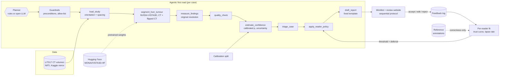

# ReaderAdapt-Liver: A self-adapting, radiologist-centred first-read agent for liver CT

> Research question of the project: *can an AI assistant adapt to the individual radiologist, rather than
> offering the same support to every reader?*

The agent performs the routine part of a read on **real liver CT (LiTS17)** - it **triages the worklist, segments
and measures the liver and liver tumours with one pretrained model, NVIDIA VISTA3D, attaches a calibrated
confidence and drafts a structured report**. Nothing is trained in this project: VISTA3D is loaded from Hugging Face
and used as published. The radiologist stays responsible for every decision and **accepts, edits or rejects** each
suggestion. Those actions are logged and used to learn **how each reader uses the AI**, so the system can change
its suggestion threshold and **defer** cases to an independent read for readers (and cases) where its help would do
more harm than good.

> ⚠️ **Research prototype - not for clinical use.** Public, de-identified data only. Simulated readers show that
> the method behaves as designed; they are not evidence of clinical benefit.


## Contents
1. [What is in the box](#1-what-is-in-the-box)
2. [Architecture](#2-architecture)
3. [Data: LiTS17](#3-data-lits17)
4. [Run it (Colab GPU)](#4-run-it)
5. [5-minute walkthrough of the website](#5-five-minute-walkthrough)
6. [Model: NVIDIA VISTA3D](#6-model-nvidia-vista3d)
7. [Tests](#7-tests)
8. [Limitations and next steps](#8-limitations-and-next-steps)


## 1. What is in the box

| | Component | Where |
|---|---|---|
| **Aim 1 - agentic first read** | Planner (deterministic rules **or an open LLM** through any OpenAI-compatible server, e.g. Ollama) that calls guarded tools: load study → segment → measure → QC → calibrated confidence → triage → reader policy → report | `radagent/agent/` |
| | Segmentation tool: **NVIDIA VISTA3D** (MONAI), a pretrained 3D CT foundation model, prompted for *liver* (label 1) and *hepatic tumour* (label 26); test-time flip pass for uncertainty. The project's only model | `radagent/models/vista3d.py` |
| | Measurements at **original resolution from header voxel spacing**; lesion volumes and RECIST-like diameters | `radagent/measure.py`, `radagent/geometry.py` |
| | **Confidence calibration** of the segmenter's case score (chosen by CV on a calibration split), Brier, ECE, reliability diagrams | `radagent/calibration.py`, `radagent/confidence.py` |
| | Deterministic, template-based **report draft** | `radagent/report.py` |
| **Aim 2 - learning from corrections** | Accept / edit / reject feedback log, **per-reader trust curve**, reader-specific threshold and **learning to defer** | `radagent/policy.py`, `radagent/readers/` |
| **Aim 3 - evaluation** | Simulated readers A (over-reliant), B (sceptical), C (inconsistent); universal vs reader-specific vs deferral policies on the same held-out LiTS cases; RQ1-RQ3 analyses | `radagent/experiments.py`, `notebooks/evaluation.ipynb` |
| Reading interface | A reading website built around the radiologist's journey and two external design reviews: no sidebar, CT viewer as the main workspace, blind first read (no AI output before your own impression, saved at once), evidence and limitations in reading order, a decision footer that stays visible with explicit save states, unsaved-work guard, session-locked settings, decision policies used only after an attributed authorisation, explicit failure states, separate mobile case cards; semantic navy / teal / amber / red / slate palette with WCAG AA contrast, 44 px targets, keyboard shortcuts - see [`docs/UX_DESIGN.md`](docs/UX_DESIGN.md) | `app/` |

An optional second-reader hook (`vlm.backend: plugin`, off by default) remains for research; the tests exercise it
with a stand-in reader.


## 2. Architecture



* **Tools compute, planners only choose.** A planner proposes the next tool; the runner checks it against an
  allow-list and the tool's preconditions and falls back to the rule planner (logged as a *guardrail override*)
  if the proposal is invalid. The planner LLM never sees pixels and never writes a finding.
* **One pretrained model, used as published.** Volumes, diameters, the case score and its uncertainty all come
  from VISTA3D's segmentation; nothing is fine-tuned.
* **Feedback never becomes ground truth.** Reader actions teach the system *how this reader uses the AI*;
  whether a decision was right always comes from the reference annotation.

---

## 3. Data: LiTS17

The project runs on the **Liver Tumor Segmentation Challenge (LiTS17)** data (ISBI 2017 / MICCAI 2017), from its
Kaggle mirror in two parts:

* [`andrewmvd/liver-tumor-segmentation`](https://www.kaggle.com/datasets/andrewmvd/liver-tumor-segmentation) -
  `segmentations/` (all 131 masks) and `volume_pt1` … `volume_pt5`;
* [`andrewmvd/liver-tumor-segmentation-part-2`](https://www.kaggle.com/datasets/andrewmvd/liver-tumor-segmentation-part-2) -
  the remaining `volume_pt*` folders.

`volume-N.nii` holds the CT in Hounsfield units, `segmentation-N.nii` the labels 0 = background, 1 = liver,
2 = tumour. `python -m radagent download` fetches both parts with `kagglehub` (cached afterwards), `python -m
radagent data` pairs every volume with its mask across both parts (`lits_000` … `lits_130`) and writes the split.
Because nothing is trained, the split is only **calib 65 / test 66** (patient-level, seeded): the calibration
split fits the confidence calibration and the reader burn-in, the test split is used once for evaluation.
Float-typed LiTS volumes are read in chunks and kept as int16 when their values are integral.

---

## 4. Run it

### 4.1 Whole pipeline on Google Colab (GPU)

Open [`notebooks/colab_lits_pipeline.ipynb`](notebooks/colab_lits_pipeline.ipynb) in Colab, choose a GPU runtime
and add one **Secret**:

| Secret | For | How |
|---|---|---|
| `KAGGLE_API_TOKEN` (or `KAGGLE_USERNAME` + `KAGGLE_KEY`) | LiTS download | kaggle.com → Settings → API |

The VISTA3D weights (~870 MB) come from Hugging Face without a token. Run all cells: download → split → fetch
VISTA3D → segment + measure every CT → calibrate → agentic first read + reports → reader experiment → figures.
The last cells either **open the website directly from Colab** (public `trycloudflare.com` link; everything works
there, including recomputing a case from its CT) or download `lits_run.zip`. VISTA3D takes roughly 1-2 min per
CT on a T4 with the flip pass (~2-3 h for all 131); `QUICK = True` gives a ~40-case first look without it.

The same steps on any GPU machine:

```bash
git clone https://github.com/AIVIETNAM-AIO-khaisiubeo/ReaderAdapt-Liver.git && cd ReaderAdapt-Liver
pip install -r requirements.txt -r requirements-deep.txt
export KAGGLE_API_TOKEN=...
python -m radagent all --config configs/lits.yaml        # or step by step:
# download | data | model | infer | calibrate | first-read | simulate | figures
```

### 4.2 Website on your own computer (no GPU needed)

```bash
pip install -U -r requirements.txt          # needs Streamlit 1.59 or newer
# unzip lits_run.zip into the outputs/ folder, then
python -m streamlit run app/streamlit_app.py -- --run outputs/lits
```

Everything in the website works from the stored run. Only *Recompute from the CT file* needs the LiTS files on
that computer (found through `data.lits_dirs` or a previous `download`), `requirements-deep.txt` and the VISTA3D
weights (a GPU is recommended). Single-case agent demo from the command line:

```bash
python -m radagent agent --config configs/lits.yaml                    # rule planner, cached perception
python -m radagent agent --config configs/lits.yaml --planner llm      # open LLM planner (see below)
python -m radagent agent --config configs/lits.yaml --recompute        # re-run VISTA3D on the CT
```

**Open-LLM planner (optional).** Install [Ollama](https://ollama.com), `ollama pull qwen2.5:7b-instruct`, keep
`ollama serve` running; `agent.llm` in the config points at `http://localhost:11434/v1`. Any OpenAI-compatible
server (vLLM, LM Studio, llama.cpp) works. If the server is unreachable or a proposal is invalid, the rule planner
takes over and the trace says so.

## 5. Five-minute walkthrough

There is no sidebar: one compact top bar holds the product and research label, the two working modes -
**Worklist** and **Read case** - and two menus, **Session** and **Research**. Design notes, the radiologist journey
and the responses to the design reviews: [`docs/UX_DESIGN.md`](docs/UX_DESIGN.md).

1. **Session** (menu) - reader, reading mode (*Blind first read* or *AI-assisted triage*), decision policy and
   worklist, plus the session, model-set and policy ids (copyable). These settings **lock** after your first saved
   impression or decision; **Start a new session** unlocks them and loads the latest authorised policy.
2. **Worklist** - a queue summary that keeps the kinds of status apart (workflow counts, technical QC issues and,
   in AI-assisted triage only, *urgent by AI rule*), one primary action (**Open next
   unread case**) and a table. In the default **blind first read** the table has no AI column at all:
   *# · Case · Image / AI QC · Reading status · Open*, in arrival order; a QC failure says what can still be done
   (*images can be read manually* / *check the series*). On a phone the list becomes separate case cards
   (*Case 01*, case id and status, QC, AI visibility, one *Open case* action).
3. **Read case** - one case bar (case id, status, *CT abdomen · axial · n slices · case k of n*, reading progress,
   **Previous** / *Go to case* / **Next**, or **P** / **N**). The CT viewer takes about 60 % of the width (*Large
   image* in the *Image* menu: about 70 %). Its toolbar is grouped: **Image** (window/level presets labelled with
   their values, e.g. *Liver · W 150 / L 70 HU*, custom W/L, zoom, pan, layout), **Overlays** (AI liver contour, AI
   lesion contour with optional fill - off by default - and the uncertainty map with opacity), **Original CT
   (O)** to hide every overlay, and **Reset**. A status line shows the active W/L, zoom and overlays and when a
   mask is locked, withheld or absent on the slice; **J** / **K** step slices.
   The side panel scrolls on its own and has three sections: **01 Independent read** (save your impression - it is
   written to disk at once), **02 Evidence and limitations** in reading order (AI finding → calibrated probability
   and its target → uncertainty and validity → supporting evidence on demand)
   and **03 Decision**, a footer that stays visible: final finding, **Save decision**, **Defer…** with a reason,
   and a save state (*Not saved / Unsaved changes / Saved hh:mm / Save failed*). The saved summary states the case,
   time, impression → final finding, the relation to the AI and *research decision saved · report draft not
   signed*; **Revise decision…** records a new decision that names the one it revises.
   Leaving a case with unsaved work (Next, Go to case, the mode switch, a menu) asks: **Save and continue**,
   **Discard and continue** or **Stay on this case**. Reopening a case after an interruption resumes with the
   saved impression.
4. **Research** (menu):
   * **Reader adaptation** - the policy active in this session next to the policy proposed from the logged
     decisions. A proposal is used only after **Authorise for future sessions** (name and role, reason,
     confirmation); it is versioned, logged and takes effect from the next session. For a simulated reader
     (Reading as *Reader B*, say), **Simulate N reads** runs an offline simulation that changes nothing.
   * **Model performance** - VISTA3D's test-split Dice and case-level AUROC (with the training-data overlap
     warning), calibration, simulated-reader policy comparison and all figures.
   * **Audit trail** - the independent impression, every decision on the case with the recommendation that was on
     screen, policy and model-set versions, and revisions; the agent's tool calls; re-run or recompute from the CT.
   * **About and intended use** - what it is and is not for, the supported-device policy and what happens when
     something fails.
   * **Show the reference annotation** overlays the dataset's reference and labels each decision as a correct
     acceptance, harmful acceptance, correct or wrong rejection. A link such as `?view=read&case=lits_028` opens a
     case directly.

## 6. Model: NVIDIA VISTA3D

| | |
|---|---|
| Model | **VISTA3D** (Versatile Imaging SegmenTation and Annotation), NVIDIA / MONAI - He et al., *VISTA3D: A Unified Segmentation Foundation Model For 3D Medical Imaging*, CVPR 2025 ([arXiv:2406.05285](https://arxiv.org/abs/2406.05285)) |
| Weights | [`MONAI/VISTA3D-HF`](https://huggingface.co/MONAI/VISTA3D-HF), `vista3d_pretrained_model/model.safetensors` (~870 MB, 218 M parameters), downloaded once by `python -m radagent model`; pin `segmenter.hf_revision` for exact reproducibility |
| Licence | code Apache-2.0; **weights NVIDIA NCLS v1 - non-commercial research use only** |
| Prompts | automatic segmentation with class prompts *liver* (1) and *hepatic tumour* (26) |
| Pre-processing | as in the published bundle: RAS orientation, 1.5 mm isotropic voxels, HU [-963.8, 1053.7] → [0, 1], 128³ sliding window |
| Uncertainty | two passes (the CT and its left-right mirror image); their disagreement is the epistemic part, the predictive entropy of the calibrated case probability the total |
| Adapter | `radagent/models/vista3d.py` - returns background / liver / tumour probabilities in the project's radiological view, so measurement, QC, viewer and report are unchanged |

> **Training-data overlap - read before quoting numbers.** VISTA3D's training data (11,454 CTs from 15 sources)
> include **MSD Task 03 (Liver), which is built from the LiTS training volumes** - the same 131 CTs as the Kaggle
> mirror used here. Segmentation Dice and case-level AUROC on LiTS are therefore **optimistic and not a held-out
> evaluation of the segmenter**; the website's *Model performance* page and the evaluation notebook say so. The
> calibration and the reader experiments are still split correctly (calib vs test). To evaluate the segmenter
> itself, use CT data outside VISTA3D's training sources.

Checked here: the adapter's geometry (orientation, anisotropic spacing, flip pass) is unit-tested with a stand-in
network, and the real weights were run on LiTS cases (e.g. `lits_000`: liver Dice 0.96, tumour Dice 0.62, on a CPU
in ~7 min; a T4 is much faster).

## 7. Tests

Tests need no GPU and no download: they write small CT volumes in the Kaggle LiTS layout and run the whole
pipeline (manifest → model card → segmenter → calibration → agent → reports → reader experiment → figures, and a
recompute from the CT) with stand-in adapter classes, both with one model and with the optional second-reader hook;
the VISTA3D adapter is checked with a stand-in network. `tests/test_app.py` drives the real website with Streamlit's AppTest and checks the
safety rules as behaviour: no AI output (and no AI column) for unread cases in a blind first read, AI evidence only
after a saved impression, impressions persisted and resumed after an interruption, settings locked after the first
save, the unsaved-work guard (save / discard / stay), revisions that never overwrite, decisions stored with the
recommendation on screen and the session / policy / model versions, a policy used only after an attributed
authorisation and only from the next session, explicit failure states (QC, missing images, a failed save), *defer*
without a final finding; plus every view for every reader, the mobile cards and the colour palette against WCAG AA.

```bash
pip install -r requirements-dev.txt && pytest -q
```

## 8. Limitations and next steps

* **The segmenter has seen LiTS.** VISTA3D's training data include MSD Task 03 (LiTS training volumes), so its
  segmentation quality here is optimistic. An external CT test set is the first next step.
* **Small held-out set.** LiTS17 only (several centres, mostly with tumour); 65 calibration and 66 test cases, so
  intervals are wide and case-level specificity rests on few tumour-free volumes
  (`confidence.target_min_tumour_ml` defines an "actionable burden" alternative).
* **One model, used as published.** No fine-tuning; the weights are for non-commercial research only. The
  uncertainty comes from a flip pass, not from an ensemble.
* **Simulated readers** are a parametric model of automation bias (Yu et al. 2024; Dratsch et al. 2023). The
  pilot with mentor radiologists (Aim 3) is what tests whether real readers behave like any of them.
* **Safe online learning.** The prototype adapts the *policy*, not the network; edits are logged (kept lesions,
  edited volume) so that a later model update can be gated against reference/consensus labels.
* Next: MRI (e.g. CHAOS / AMOS), lesion-level deferral, interactive correction with VISTA3D's point prompts, and
  reading-time logging in the website for the pilot.
