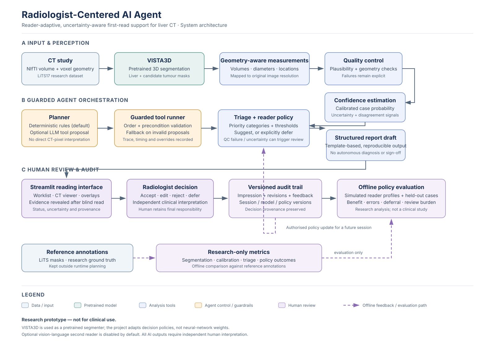

<div align="center">

# Radiologist-Centered AI Agent

### Reader-adaptive, uncertainty-aware first-read support for liver CT

[](https://www.python.org/)
[](https://streamlit.io/)
[](#)
[](LICENSE)

**Can an AI assistant adapt to how an individual radiologist uses AI, while recognising when it should defer?**

A research prototype that connects pretrained 3D CT segmentation, original-resolution measurements, calibrated case-level confidence, transparent worklist triage, reader-specific decision policies, and an auditable review interface.

[Architecture](#architecture) · [Workflow](#end-to-end-workflow) · [Setup](#setup-and-running) · [Evaluation](#evaluation-design) · [Limitations](#limitations-and-intended-use)

</div>

> [!WARNING]
> **Research prototype — not for clinical use.** This software is not validated for diagnosis, treatment decisions, or patient management. A qualified radiologist must independently interpret the images and remains responsible for every finding. Model-generated measurements, priorities, probabilities, and report text must not be treated as clinical advice.

> [!IMPORTANT]
> **Current-checkout setup caveat:** the `main` branch imports `radagent.data.lits` from the CLI, pipeline, UI, and tests, but that module is not present in the tracked repository tree. The Colab notebook also points to the separate `ReaderAdapt-Liver` repository/`vista3d-single-model` branch and uses `configs/lits_colab.yaml`, which is not tracked here. Consequently, a clean, end-to-end LiTS run is **not reproducible from this checkout as it stands**. Restore the missing data module and reconcile the notebook/config references before following the full-pipeline commands below. This README documents the implemented design and intended workflow without claiming those setup gaps are resolved.

---

## Contents

- [Project overview](#project-overview)
- [Architecture](#architecture)
- [End-to-end workflow](#end-to-end-workflow)
- [Dataset and label conventions](#dataset-and-label-conventions)
- [Repository map](#repository-map)
- [Setup and running](#setup-and-running)
- [Outputs and artifacts](#outputs-and-artifacts)
- [Configuration](#configuration)
- [Evaluation design](#evaluation-design)
- [Tests](#tests)
- [Limitations and intended use](#limitations-and-intended-use)
- [References and licences](#references-and-licences)

## Project overview

The project explores a **radiologist-centred first-read workflow** on the [Liver Tumor Segmentation Challenge 2017 (LiTS17)](https://www.kaggle.com/datasets/andrewmvd/liver-tumor-segmentation) CT dataset. It is built around three research aims:

| Aim | Question | Main implementation |
|---|---|---|
| **1. Agentic first read** | Can a traceable agent organise a routine first read and prepare evidence for a human reviewer? | `radagent/agent/`, `radagent/pipeline.py`, `radagent/report.py` |
| **2. Adaptation from reader feedback** | Can suggestion thresholds and deferral behaviour reflect how a particular reader uses AI? | `radagent/policy.py`, `radagent/readers/`, `app/ui_core.py` |
| **3. Controlled evaluation** | How do universal, reader-specific, and deferral policies compare in a simulated reader study? | `radagent/experiments.py`, `radagent/plots.py`, `notebooks/evaluation.ipynb` |

The segmentation model is **NVIDIA VISTA3D**, loaded from the [MONAI/VISTA3D-HF checkpoint](https://huggingface.co/MONAI/VISTA3D-HF) and used as a pretrained model. **This project does not train or fine-tune the network.** The software measures predicted liver and lesion geometry, estimates case-level tumour probability and uncertainty, checks output plausibility, prioritises the worklist, and drafts a deterministic structured report.

Reader actions—accept, edit, reject, or defer—are logged with the impression, recommendation, session identity, policy version, and model-set version. These interactions can inform a reader-specific decision policy. **Reader feedback is not ground truth:** correctness is assessed against the dataset's reference annotation in research analyses, not inferred from whether a reader accepted the AI.

An optional vision-language second-reader adapter is available for experiments, but `vlm.backend` defaults to `none`. In the default configuration, VISTA3D is the only AI model in the pipeline.

## Architecture

The figure summarises the end-to-end system: pretrained CT perception, guarded agent orchestration, reader-facing decision support, and an offline feedback/evaluation loop. Solid arrows show the main runtime workflow; dashed arrows denote offline feedback or research-only evaluation. Reference annotations are isolated from runtime planning.

<div align="center">
  
  <p><em>Figure 1. Overall architecture of the reader-adaptive, uncertainty-aware liver CT research prototype.</em></p>
</div>

### Core design principles

- **The model computes; the planner coordinates.** The deterministic rule planner is the default. An optional open LLM can propose the next tool through an OpenAI-compatible endpoint, but it receives tool descriptions and summaries—not CT pixels—and does not write findings. The runner validates tool order and preconditions; invalid proposals fall back to the rule planner and are recorded in the trace.
- **Measurements preserve physical geometry.** NIfTI orientation and header spacing are carried through processing. Volumes and diameters are computed using the original image resolution and voxel spacing rather than treating resized model pixels as physical measurements.
- **Uncertainty and validity are separate.** Flip-based test-time augmentation provides a pass-disagreement signal; predictive entropy describes case-level uncertainty. Independent quality checks can still fail even when a prediction appears confident.
- **Deferral is an explicit outcome.** Quality-control failures and sufficiently uncertain cases can have their AI suggestion withheld so the case receives an independent read.
- **Adaptation is governed, not silent.** Proposed policies are versioned and logged. The interface requires an attributed authorisation before a learned policy is activated, and it applies from the next session rather than changing the rules mid-session.
- **Every reader decision is auditable.** The impression is saved before AI evidence is revealed in the default blind-first-read mode. Revisions retain the earlier decision and record what they supersede.

## End-to-end workflow

### 1. Data and study preparation

The intended data layer discovers LiTS CT/mask pairs from the two Kaggle dataset parts, assigns stable IDs (`lits_000` … `lits_130`), writes a manifest, and creates a seeded calibration/test split. Since no network is trained, the default split is approximately **65 calibration cases and 66 test cases** for all 131 cases. Calibration cases are used to fit/select confidence calibration and support the reader-policy burn-in; test cases are reserved for evaluation.

### 2. Segmentation and measurements

`radagent/models/vista3d.py` wraps VISTA3D with MONAI. The configured preprocessing follows the model bundle: RAS orientation, resampling to 1.5 mm isotropic voxels, clipping/scaling the CT intensity range of approximately `[-963.8, 1053.7] HU` to `[0, 1]`, and sliding-window inference with 128³ patches. The adapter prompts VISTA3D for liver (label `1`) and hepatic tumour (label `26`). A left-right mirrored pass is enabled by default.

`radagent/inference.py` post-processes the probability maps and computes a raw case-level tumour score from the top-k smoothed tumour probabilities in a dilated liver region. The default target corresponds to a small lesion burden of roughly 0.1 ml; this raw score is **not yet a calibrated probability**.

`radagent/measure.py` maps the predictions back to the original-resolution image grid and estimates liver and candidate-lesion volumes, largest axial diameters, slice ranges, centroids, mean attenuation, and predicted tumour burden. Physical volumes use the NIfTI header's voxel spacing.

### 3. Quality control, confidence, and triage

`radagent/quality.py` checks operational plausibility, including whether a liver was found, plausible liver volume, voxel spacing, number of slices, and tumour predictions outside the liver. Failed checks are visible to the workflow and can force a manual read.

`radagent/calibration.py` selects among identity, temperature, and Platt scaling on the calibration split using stratified cross-validated negative log-likelihood (NLL). When an optional second reader is configured and sufficient data are available, it can also compare second-reader-only and fused calibration. `radagent/confidence.py` reports the calibrated case-level probability and uncertainty components.

`radagent/triage.py` assigns each case a transparent priority and one of the following categories:

| Category | Meaning in this research prototype |
|---|---|
| `QC FAIL` | Technical quality checks failed; full manual review is required. |
| `URGENT` | The configured AI rule identifies a high probability plus a lesion-size/burden criterion. This is **not a clinically validated urgency decision**. |
| `SUSPICIOUS` | The calibrated probability reaches the configured suggestion threshold. |
| `UNCERTAIN` | The uncertainty is high, or configured AI tools disagree. |
| `LIKELY NORMAL` | The configured AI rule does not suspect tumour and no higher-priority condition applies. This is **not a negative diagnosis**. |

### 4. Agentic orchestration and report drafting

The agent in `radagent/agent/` runs an ordered, preconditioned tool chain:

`load_study` → `segment_liver_tumour` → `measure_findings` → `quality_check` → optional `vlm_second_read` → `estimate_confidence` → `triage_case` → optional `apply_reader_policy` → `draft_report` → `finish`.

Each step is stored in a per-case trace with the proposed planner, selected tool, result summary, duration, and any guardrail override. `radagent/report.py` renders measured values and model results through a fixed template so that the draft is reproducible. Optional vision-language text is separated, labelled unverified, and guarded; it is not used to calculate lesion measurements or directly determine triage.

### 5. Reader workflow and feedback

The Streamlit interface is documented in [`docs/UX_DESIGN.md`](docs/UX_DESIGN.md). It has two primary modes—**Worklist** and **Read case**—plus **Session** and **Research** menus.

1. In **Blind first read** mode (the default), an unread case is presented without AI predictions or overlays. The reader records and saves an independent impression first.
2. After saving the impression, the reader can review the model evidence, measurements, probability, uncertainty, and quality status.
3. The reader records a final finding or defers, with optional notes/edits. The decision is saved with the recommendation and the model/policy/session versions shown at that time.
4. Session settings lock after the first saved impression or decision. Unsaved edits trigger a save/discard/stay prompt; revisions never overwrite past decisions.
5. The Research area exposes the audit trail, model performance, policy proposals, and reference annotations for research review. A policy proposal needs explicit authorisation to become active in a future session.

### 6. Reader-policy experiments

`radagent/policy.py` fits a regularised logistic trust curve and estimates a reader's lapse rate from sequential feedback. Candidate suggestion thresholds and uncertainty cut-offs are evaluated with a weighted loss for false negatives, false positives, and review burden. A reader-specific policy is adopted only when there is enough feedback and its estimated improvement exceeds the configured criteria; otherwise the universal policy remains in place.

`radagent/experiments.py` compares a no-AI control, a universal threshold, universal deferral, a reader-specific threshold, and a reader-specific threshold with deferral. It simulates three reader profiles (over-reliant, sceptical, and inconsistent), uses the same held-out test cases and common random draws for policy comparisons, repeats the study across seeds, and produces learning-curve and benefit-spread analyses.

## Dataset and label conventions

The intended dataset source is the public LiTS17 Kaggle mirror:

- [Part 1 — segmentations and `volume_pt1` … `volume_pt5`](https://www.kaggle.com/datasets/andrewmvd/liver-tumor-segmentation)
- [Part 2 — remaining CT volumes](https://www.kaggle.com/datasets/andrewmvd/liver-tumor-segmentation-part-2)

| Item | Convention |
|---|---|
| CT | `volume-N.nii` — CT intensity in Hounsfield units (HU) |
| Reference mask | `segmentation-N.nii` |
| Reference labels | `0` background, `1` liver, `2` tumour |
| VISTA3D prompts | `1` liver, `26` hepatic tumour |
| Internal probability channels | `0` background, `1` liver parenchyma, `2` tumour |
| Split | Seeded, case-level `calib` / `test`; no training split because this project does not train a model |

Reference annotations are used for research metrics and evaluation only. They must not be exposed to the planning module or confused with a clinical ground truth for prospective use.

## Repository map

```text
.
├── app/
│   ├── streamlit_app.py       # Main radiologist-facing Streamlit application
│   ├── ui_core.py             # Worklist, image rendering, policy and persistence logic
│   └── ui_theme.py            # Shared visual components, semantic colours and responsive styles
├── configs/
│   └── lits.yaml              # Main experiment configuration
├── docs/
│   └── UX_DESIGN.md           # Reading journey, design rules and usability considerations
├── notebooks/
│   ├── colab_lits_pipeline.ipynb  # Colab-oriented pipeline notebook (see setup caveat above)
│   └── evaluation.ipynb          # Evaluation and analysis notebook
├── radagent/
│   ├── agent/                 # Rule/LLM planners, tool definitions and guarded runner
│   ├── models/                # Model interfaces and VISTA3D adapter
│   ├── readers/               # Feedback events and simulated-reader profiles
│   ├── vlm/                   # Optional second-reader interface and output guardrails
│   ├── calibration.py         # Calibration models and metrics
│   ├── confidence.py          # Case probability and uncertainty
│   ├── config.py              # Defaults, YAML merge and run paths
│   ├── experiments.py         # Controlled reader simulation
│   ├── geometry.py            # NIfTI geometry and orientation conventions
│   ├── inference.py           # Segmentation post-processing and raw case score
│   ├── measure.py             # Original-resolution measurements and reference metrics
│   ├── pipeline.py            # Pipeline orchestration and cached run stages
│   ├── plots.py               # Evaluation visualisations
│   ├── policy.py              # Reader-specific thresholds and deferral
│   ├── report.py              # Deterministic structured report draft
│   ├── store.py               # Run artefacts, JSON/NPZ persistence
│   ├── triage.py              # Worklist categories and ranking
│   └── io/nifti.py            # NIfTI reader/writer
├── tests/
│   ├── fixtures/              # Synthetic CT phantoms and stub model adapters
│   ├── test_app.py            # UI workflow, state, accessibility and audit behaviour
│   ├── test_core.py           # Core geometry, calibration, policy and agent guardrails
│   └── test_lits_pipeline.py  # Intended data/inference/calibration end-to-end tests
├── tools/
│   └── make_notebooks.py      # Notebook generation utility
├── requirements.txt           # Core app and data-processing dependencies
├── requirements-deep.txt      # PyTorch / MONAI dependencies for VISTA3D inference
├── requirements-dev.txt       # Development/test dependencies
├── pyproject.toml             # Package metadata and optional dependency group
└── README.md
```

**Missing-file note:** the current tracked tree has no `radagent/data/lits.py` package even though the pipeline and tests import it. The tree above lists tracked files only; it does not imply that the data layer is currently complete.

## Setup and running

### Requirements

- Python **3.10 or newer**.
- For the stored-run website and core processing: dependencies in `requirements.txt`.
- For VISTA3D inference: PyTorch and MONAI from `requirements-deep.txt`; a CUDA-capable GPU is recommended. CPU inference is possible but slow and memory-intensive.
- For LiTS acquisition: a Kaggle API credential accepted by KaggleHub.
- For the optional LLM planner: an OpenAI-compatible chat-completions server such as Ollama, vLLM, LM Studio, or llama.cpp server.

### 1. Clone and install

```bash
git clone https://github.com/AIVIETNAM-AIO-khaisiubeo/Radiologist-Centered-AI-Agent.git
cd Radiologist-Centered-AI-Agent

python -m venv .venv
# Linux / macOS
source .venv/bin/activate
# Windows PowerShell: .venv\Scripts\Activate.ps1

python -m pip install --upgrade pip
python -m pip install -e .
python -m pip install -r requirements.txt -r requirements-deep.txt
```

If you need a particular CUDA build of PyTorch, install the matching build for your machine using the [official PyTorch installation selector](https://pytorch.org/get-started/locally/) before resolving the remaining deep dependencies.

### 2. Configure Kaggle credentials

Create an API token in your [Kaggle account settings](https://www.kaggle.com/settings) and make it available to the runtime using one of the supported environment-variable combinations:

```bash
# Preferred when supported by your KaggleHub setup
export KAGGLE_API_TOKEN="<your-token>"

# Alternatively, configure both values
export KAGGLE_USERNAME="<your-username>"
export KAGGLE_KEY="<your-key>"
```

For Windows PowerShell, use `$env:KAGGLE_API_TOKEN = "<your-token>"` or set `KAGGLE_USERNAME` and `KAGGLE_KEY`. Do not commit secrets to the repository or notebook.

### 3. Intended pipeline commands

> These commands describe the CLI exposed by `radagent/cli.py`. **They will not complete on a clean checkout until the missing `radagent.data.lits` module noted above is restored.** The Colab notebook also needs its repository, branch and config references aligned with this repository.

```bash
# Full workflow (dataset preparation, model card, inference, calibration,
# first-read reports, reader simulation and figures)
python -m radagent all --config configs/lits.yaml

# Or run each stage separately
python -m radagent download  --config configs/lits.yaml
python -m radagent data      --config configs/lits.yaml
python -m radagent model     --config configs/lits.yaml
python -m radagent infer     --config configs/lits.yaml
python -m radagent calibrate --config configs/lits.yaml
python -m radagent first-read --config configs/lits.yaml
python -m radagent simulate --config configs/lits.yaml
python -m radagent figures  --config configs/lits.yaml
```

The CLI caches per-case analysis, so repeated inference steps can reuse stored predictions. Use `--force` with `infer` or `vlm` to recompute cached results. The optional second-reader stage is skipped by default because `vlm.backend` is `none`.

### 4. Open the review website

The website reads a completed run directory. For example, after a run named `lits` has been generated or copied into `outputs/lits/`:

```bash
python -m streamlit run app/streamlit_app.py -- --run outputs/lits
```

Alternatively, set `RA_RUN=outputs/lits`. The run directory needs case records and the related viewer/report artefacts for the corresponding pages to show meaningful data. The interface can display its onboarding state without a completed run; that is not the same as a completed analysis.

A saved run can be reviewed without running the neural network again. Recomputing a case from its source CT requires the CT files to be available on that machine, the data-location helper, PyTorch/MONAI and VISTA3D weights. A GPU is recommended.

### 5. Optional open-LLM planner

The planner is a coordinator only; it does not analyse pixels or author finding values. The configured default is Ollama with `qwen2.5:7b-instruct` at `http://localhost:11434/v1`.

```bash
ollama pull qwen2.5:7b-instruct
ollama serve
# After the data-layer/setup caveat has been resolved and a valid run exists:
python -m radagent agent --config configs/lits.yaml --planner llm
```

The API key environment-variable name is configured by `agent.llm.api_key_env` (default `LLM_API_KEY`). For a local Ollama endpoint the client defaults to the placeholder key `ollama` when this variable is unset. Invalid or unavailable LLM proposals fall back to the deterministic rule planner.

### Colab notebook status

`notebooks/colab_lits_pipeline.ipynb` currently clones `AIVIETNAM-AIO-khaisiubeo/ReaderAdapt-Liver`, checks out `vista3d-single-model`, and expects `configs/lits_colab.yaml`. These are not the repository, branch, or config tracked here. Do not assume **Run all** will execute successfully until the notebook is updated alongside the missing data module.

## Outputs and artifacts

A normal run is stored at `outputs/<run_name>/` (by default `outputs/lits/`). The output layout implemented by `radagent/store.py` is:

```text
outputs/lits/
├── manifest.csv                  # Case list, data paths and calib/test split
├── config_used.yaml              # Effective experiment configuration
├── model/
│   └── model_card.json           # Model identity, weight source and licensing caveat
├── cache/analysis/<case>.json    # Cached segmentation summary, measurements and reference metrics
├── viewer/<case>.npz             # Compact CT slices and overlay/probability arrays for the app
├── calibration/
│   ├── calibrator.json           # Fitted calibration mapping
│   └── calibration_metrics.json  # Metrics and reliability-bin data
├── cases/<case>.json             # Structured case record for UI and evaluation
├── traces/<case>.json            # Agent execution trace and guardrail events
├── reports/<case>.txt             # Unsigned, template-based report draft
├── feedback/<reader>.jsonl       # Reader feedback events
├── experiments/                  # CSV/JSON reader-policy results and metadata
└── figures/                       # Saved calibration, segmentation and policy plots
```

Per-case cache files are reused when the stored model signature matches the current settings. Changing the segmentation backend, model revision, preprocessing resolution or relevant inference settings invalidates the cache signature.

## Configuration

The default experiment is defined in [`configs/lits.yaml`](configs/lits.yaml), with defaults and deep-merge behaviour in [`radagent/config.py`](radagent/config.py). Parameters that may be worth reviewing include:

| Section | Representative settings | Purpose |
|---|---|---|
| `data` | `lits_dirs`, `split_fractions`, `max_cases` | Dataset locations and reproducible calibration/test split |
| `segmenter` | `backend`, `hf_revision`, `resample_mm`, `roi_size`, `overlap`, `device` | VISTA3D weights, inference geometry and compute device |
| `inference` | `tta_flip`, `min_lesion_ml`, `min_lesion_peak_prob`, `viewer_size` | Flip pass, candidate filtering and stored viewer resolution |
| `confidence` | `method`, `n_bins`, `target_min_tumour_ml` | Calibration selection, reliability metrics and target definition |
| `quality` | `liver_ml_range`, `spacing_mm_range`, `min_slices` | Operational QC thresholds |
| `triage` | `suggest_threshold`, `urgent_probability`, priority weights | Worklist sorting and rule-based categories |
| `policy` | `threshold_grid`, `defer_grid`, `min_feedback`, `min_improvement` | Threshold/deferral search and safeguards against weak evidence |
| `readers` | `seeds`, `learning_curve_n`, `profiles` | Simulated reader behaviour and experiment repetitions |
| `agent` | `planner`, `max_steps`, `llm` | Rule-based or OpenAI-compatible LLM planning |
| `vlm` | `backend`, `plugin`, `n_slices`, `windows` | Optional second-reader extension; disabled by default |

The YAML file only needs to override selected defaults. For reproducibility, pin `segmenter.hf_revision` to a specific Hugging Face revision when preparing a formal experiment, record the effective `config_used.yaml`, and retain the generated model card and run metadata.

## Evaluation design

The code and `notebooks/evaluation.ipynb` are organised around the following analyses:

- **Segmentation and measurements:** liver/tumour Dice and lesion-detection metrics against LiTS annotations; volumes and diameters are evaluated at original resolution.
- **Case-level confidence:** raw versus calibrated metrics including Brier score, expected calibration error (ECE), negative log-likelihood (NLL), AUROC, reliability diagrams, and bootstrap intervals.
- **Selective prediction:** relationship between uncertainty, retained-case coverage, and error.
- **Worklist triage:** proportion of reference-positive cases surfaced as higher-priority cases are reviewed.
- **Reader policies:** accuracy, sensitivity, specificity, weighted error, deferral rate, review burden, harmful acceptance, and over-reliance for simulated readers.
- **Research questions:** whether adaptation reduces between-reader differences in AI benefit, whether deferral reduces harmful acceptance, and how much feedback is required before policy changes become beneficial and stable.

The calibration split is used to select and fit the calibration mapping and collect simulated-reader burn-in feedback. Policies are then compared on the same test cases with common random draws, and the simulation is repeated across configured seeds. These are **simulated-reader experiments**, not a clinical reader study.

### Critical evaluation caveat: LiTS overlap with VISTA3D training

VISTA3D's published training sources include MSD Task 03 (Liver), which is built from LiTS training volumes. The 131 LiTS cases used in this project therefore overlap with the model's training data. **LiTS segmentation Dice and case-level AUROC are optimistic and must not be presented as independent, held-out validation of VISTA3D.** The calibration/test split separates this project's calibration and reader-policy analyses, but it does not remove the model's pretraining overlap. An external CT dataset that is disjoint from VISTA3D's training sources is needed to evaluate segmentation generalisation.

## Tests

The repository contains synthetic CT phantoms, stand-in segmentation/VLM adapters, core tests, Streamlit interaction tests, and intended end-to-end pipeline tests. The test files cover NIfTI geometry, original-spacing measurements, calibration, agent tool-order guardrails, triage, report generation, feedback persistence, blind-first-read behaviour, policy authorisation, revisions, failure states, and the VISTA3D adapter's geometry/class assembly.

After restoring `radagent.data.lits`, install the development dependency and run:

```bash
python -m pip install -r requirements-dev.txt
pytest -q
```

The missing data-layer module currently prevents the LiTS pipeline test module from importing, so a passing full-suite result cannot be claimed for the current checkout. The core tests can be run separately while that issue is being addressed:

```bash
pytest -q tests/test_core.py
```

## Limitations and intended use

- **Not clinically validated.** No diagnostic-performance, workflow, safety, or usability validation in clinical practice is claimed.
- **Pretraining overlap.** The evaluated LiTS data overlap with VISTA3D's documented training sources; use an external dataset for an independent model evaluation.
- **Small single-dataset evaluation.** With 65 calibration and 66 test cases, uncertainty intervals can be wide and specificity estimates can depend on a small number of tumour-free cases.
- **Coarse uncertainty estimate.** The default two-pass flip test-time augmentation is not an ensemble and does not capture all sources of model uncertainty.
- **Simulated readers are hypotheses.** The three reader profiles are parametric simulations of different automation-bias behaviours, not substitutes for observed radiologist decisions.
- **No online model learning.** The project adapts decision policy candidates, not neural-network weights. Feedback must not be treated as a substitute for reference/consensus annotations.
- **Prototype software.** Window/level presets, overlays, mobile layouts, and outputs are not validated for diagnostic displays or patient care.
- **Incomplete setup in this branch.** The absent `radagent.data.lits` module and stale Colab references must be corrected before reproducing the complete pipeline.

Potential future work described by the project includes external CT validation, pilot studies with radiologists, lesion-level deferral, interactive correction, additional modalities, and reading-time analysis.

## References and licences

1. **VISTA3D:** He et al., *VISTA3D: A Unified Segmentation Foundation Model For 3D Medical Imaging*, CVPR 2025. [arXiv:2406.05285](https://arxiv.org/abs/2406.05285).
2. **Pretrained checkpoint:** [MONAI/VISTA3D-HF on Hugging Face](https://huggingface.co/MONAI/VISTA3D-HF). Weights are downloaded and cached on first use unless a local checkpoint is configured.
3. **LiTS17:** [Liver Tumor Segmentation Challenge dataset mirror — Part 1](https://www.kaggle.com/datasets/andrewmvd/liver-tumor-segmentation) and [Part 2](https://www.kaggle.com/datasets/andrewmvd/liver-tumor-segmentation-part-2).
4. **Interface design:** [`docs/UX_DESIGN.md`](docs/UX_DESIGN.md) records the intended reading workflow, design rationale, failure handling and formative usability scenarios.

**Software licence:** this repository's code is distributed under the MIT License; see [`LICENSE`](LICENSE). The pretrained VISTA3D weights have a separate NVIDIA NCLS v1 licence described in the model adapter and are for **non-commercial research use only** under the terms noted by the project. The code licence does not override the model-weight licence or the dataset's terms. Review the applicable licences before redistributing weights or using the system in any commercial context.

---

<div align="center">

**Human judgement first. Uncertainty made visible. Every decision auditable.**

[Back to top](#radiologist-centered-ai-agent)

</div>
